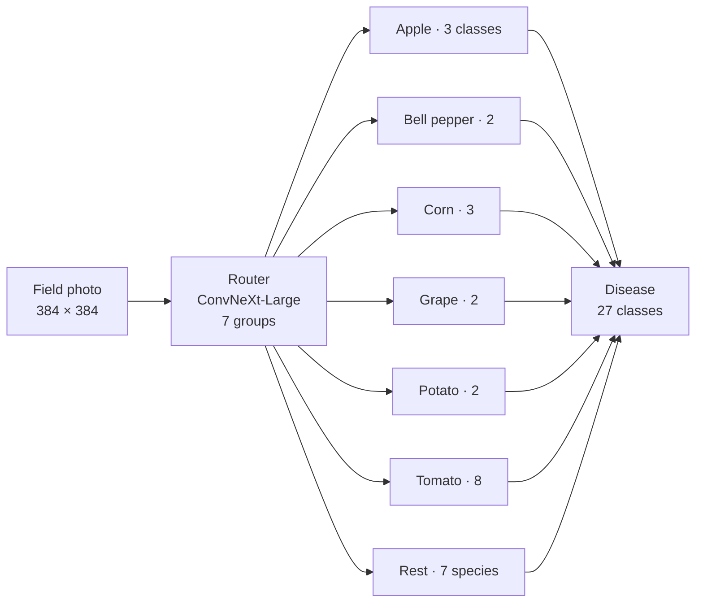

# SpecialistRoute

**Hierarchical plant-disease classification on PlantDoc: a crop router sends each field photo to one of seven crop-specific disease specialists.**


SpecialistRoute was developed at **CERERE, American University in Cairo**, under the supervision of **Prof. Dr. Maki K. Habib**. It is evaluated under a strict protocol: the official test set is kept untouched, checkpoints are selected on held-out validation, train–test leakage is removed, and every result is averaged over 5 seeds.

| | Official PlantDoc test set (236 images) |
| --- | --- |
| Single model (mean ± SD, 5 seeds) | **72.80% ± 1.57%** (95% CI 70.85–74.74) |
| 5-seed ensemble | **75.42%** (178 / 236) |
| Routing accuracy (crop identified correctly) | 94.6% |

---

## Contents

- [How it works](#how-it-works)
- [Results](#results)
- [Key findings](#key-findings)
- [Repository structure](#repository-structure)
- [Installation](#installation)
- [Data preparation](#data-preparation)
- [Usage](#usage)
- [Evaluation protocol](#evaluation-protocol)
- [Known issues](#known-issues)
- [Roadmap](#roadmap)
- [Acknowledgements](#acknowledgements)
- [License](#license)

---

## How it works



- **Router:** a 7-class ConvNeXt-Large classifier that predicts the crop group: six crops plus a **Rest** group.
- **Specialists:** one model per crop, each trained only on that crop's classes. **Rest** is a single grouped model for the seven species that have just one class each (Blueberry, Cherry, Peach, Raspberry, Soyabean, Squash, Strawberry).
- **Hard routing:** each image goes only to the router's top prediction. A routing mistake cannot be recovered downstream.
- **Ensemble (optional):** the softmax outputs of all 5 seeds are averaged, for the router and for every specialist.

---

## Results

### Assembled pipeline

| Measure | Single model (5 seeds) | 5-seed ensemble |
| --- | --- | --- |
| All 236 test images | 72.80% ± 1.57% | 75.42% |
| 216 original test images | 76.02% ± 1.80% | 78.70% |
| 20 restored test images | 38.0% ± 5.7% | 40.0% |
| Routing accuracy | 94.63% ± 0.84% | 94.49% |

The two kinds of interval measure different things. The single-model CI reflects variation between seeds with the test set held fixed. The ensemble's bootstrap CI (69.92–80.51) reflects uncertainty from having only 236 test images.

### Per component (test accuracy, mean ± SD over 5 seeds)

Each component is scored on its own test images, assuming perfect routing.

| Component | Model | Accuracy |
| --- | --- | --- |
| Router (Classifier) | ConvNeXt-Large | 93.81% ± 0.77% |
| Grape | ConvNeXt-Base | 99.00% ± 2.24% |
| Rest | ConvNeXt-Large | 91.86% ± 1.42% |
| Apple | ConvNeXt-Large | 88.97% ± 1.54% |
| Bell pepper | ConvNeXt-Base | 80.00% ± 7.89% |
| Corn | ConvNeXt-Base | 75.38% ± 4.39% |
| Potato | ConvNeXt-Base | 70.00% ± 12.02% |
| Tomato | ConvNeXt-Large | 56.52% ± 1.02% |

### Comparison with the literature

| Work | Accuracy | Protocol |
| --- | --- | --- |
| El Karch et al. 2026 (*Frontiers in Plant Science*) | 76.97% ± 1.48% | Official split, held-out validation, 5 seeds (directly comparable) |
| **SpecialistRoute, single model** | **72.80% ± 1.57%** | Official split, held-out validation, 5 seeds |
| **SpecialistRoute, 5-seed ensemble** | **75.42%** | Same protocol, 5× inference cost |

Many published PlantDoc numbers use random re-splits or select checkpoints on the test set, so they are not directly comparable.

---

## Key findings

1. **Evaluation shortcuts inflated accuracy by 11.5 pp.** The project's earlier protocol (v1) reported 84.27%. Of the drop to 72.80%, 8.25 pp came from methodology (checkpoints selected on test, train–test near-duplicates) and 3.22 pp from 20 low-quality test images.
2. **An explicit Rest class beats a confidence threshold.** A 7-class router with Rest outperformed a 6-class router with a threshold by 18.5 pp.
3. **Confidence re-routing between specialists does not work,** because specialists are overconfident on images from other crops.
4. **Seed ensembling adds +2.6 pp,** and the ensemble beats every single seed. Horizontal-flip test-time augmentation and soft routing add nothing.
5. **Pipeline accuracy can be predicted from the components:** router recall × specialist accuracy matches the measured value within 0.1–0.4 pp.
6. **Difficulty is in the data, not the model.** A frozen linear probe reproduces the trained specialists' difficulty ranking, and species labels are clean (2.0% flagged by confident learning).
7. **Tomato is the bottleneck** (about half of all errors), and Potato is often routed to Tomato.

---

## Repository structure

```
SpecialistRoute/
├── notebooks/
│   ├── PlantDoc_Main.ipynb            # config, data, training, evaluation, ensemble, analyses
│   ├── PlantDoc_LabelQuality.ipynb    # 5-fold out-of-fold label-quality analysis (optional)
│   └── prepare_final_dataset.ipynb    # notebook version of the data-prep script
├── scripts/
│   ├── prepare_final_dataset.py       # builds the v2 dataset + reports
│   ├── verify_clahe_dataset.py        # checks every stored image is one CLAHE pass of its original
│   ├── collect_v2_results.py          # gathers all results into v2_all_results.xlsx
│   └── gmp_layer.py                   # generalized-mean pooling layer (v1 experiment)
├── results/
│   └── SpecialistRoute_v2_results.csv # every reported v2 number, one row per value
├── docs/handover/                     # 9 handover documents (PDF): guide, setup, data, configs,
│                                      # experiments, results, known issues, future work, code reference
├── archive/
│   └── PlantDoc_Archive_Tools.ipynb   # retired v1 cells, reference only
├── requirements.txt
└── README.md
```

Datasets, checkpoints and experiment outputs are not stored in the repository (see `.gitignore`).

Expected data and output layout:

```
PlantDoc/
├── Datasets/
│   ├── dataset/{train,val,test}/      # final v2 data
│   ├── reports/                       # manifest, exclusions, duplicate review
│   └── derived_v2/                    # built automatically by the main notebook
├── Experiments/                       # one folder per component: v2_<Component>/
└── Models/                            # ImageNet no-top weights (offline)
```

---

## Installation

```bash
python3 -m venv ~/tf_env
source ~/tf_env/bin/activate
pip install -r requirements.txt
```

- A GPU is needed for training; all reported runs used one local GPU.
- On Ubuntu the system Python is "externally managed", so always install into the virtual environment. Inside a notebook, use `%pip install <package>`.
- `keras-cv` is imported by the main notebook even though RandAugment is switched off.
- To run offline, put `convnext_base_notop.h5` and `convnext_large_notop.h5` in `Models/` and point `MODEL_PATHS` (main notebook, section 2) at them.

---

## Data preparation

1. Download PlantDoc from Kaggle (2,316 train / 236 test images, 27 classes).
2. Set the paths in `CONFIG` at the top of `scripts/prepare_final_dataset.py`. `img_size` must be **224**.
3. Run it. The **first pass stops** after writing `reports/near_duplicate_review.csv` and one side-by-side image per near-duplicate pair.
4. Fill `is_duplicate` with `y` (same photo) or `n` (different photo) for every pair, then run the script again.
5. Verify the result: set `VERIFY` in `scripts/verify_clahe_dataset.py` to the **raw** Kaggle folders and run it. Expected: 0 images flagged.

**Result:** 1,897 train / 209 validation / 236 test images. 104 training images are excluded as leaks or duplicates, and the official test set is complete.

All images are CLAHE-processed once, offline: resize to 224 → LAB → CLAHE on the L channel (clip limit 2.0, 8×8 tiles) → BGR. At load time they are upscaled to 384 with TensorFlow bilinear resizing.

---

## Usage

All settings live in **section 2** of `notebooks/PlantDoc_Main.ipynb` (`CONFIG_BASE`, `COMPONENTS`). Restart the kernel and run **sections 1–8** (definitions only) before anything else.

**Check the setup**

```python
check_protocol()        # expects train 1,897 / val 209 / test 236, no shared images, RESULT: OK
```

**Train everything (section 9b).** This trains 8 components × 5 seeds with Classifier first, evaluates the pipeline after each seed, and resumes after a crash.

```python
run_all_state = run_all([42, 123, 2024, 779, 1027],
                        ["Classifier", "Apple", "Bell_pepper", "Corn", "Potato", "Tomato", "Grape", "Rest"],
                        stop_on_error=False, evaluate=True)
```

**Train or test one component (section 10)**

```python
apply_component("Tomato", multi_seed_list=[42], epochs=5)   # overrides are optional
assert check_protocol()
run_multi_seed_experiment(CONFIG["models_to_train"])
```

**Evaluate the assembled pipeline for a seed (section 8)**

```python
df, summary = evaluate_pipeline(42)          # expected: 176 / 236 = 74.58%
theoretical_pipeline(42, df)
```

**Seed ensemble (section 11).** Predictions are cached with one subprocess per model, which avoids out-of-memory errors.

```python
write_cache_jobs(splits=("val", "test"), tta=True)
run_cache_jobs(batch_size=8)                 # re-run until all jobs are complete
check_matches_section8([42, 123, 2024, 779, 1027])
compare_variants("val", [42, 123, 2024, 779, 1027])   # choose on validation only
report_final([42, 123, 2024, 779, 1027], tta=False, routing="hard")   # test, once
```

**Collect results**

```bash
~/tf_env/bin/python scripts/collect_v2_results.py    # writes Experiments/v2_all_results.xlsx
```

---

## Evaluation protocol

| Rule | Implementation |
| --- | --- |
| Official test set, never edited | All 236 Kaggle test images (20 restored from the originals) |
| Test used only for final reporting | Checkpoints and design choices are decided on validation |
| Checkpoint selection | Lowest `val_loss` on a held-out 10% validation split |
| No train–test leakage | MD5 + reviewed perceptual-hash duplicates removed from train only |
| Look-alike images stay on one side | Validation split grouped by reviewed near-duplicate pairs |
| Seeds | 42, 123, 2024, 779, 1027; mean ± SD and 95% t-interval |
| Ties | A difference of ≤ 1 validation image keeps the simpler option |

---

## Known issues

- **Fine-tuning may never unfreeze the backbone.** `FineTuneCallback` sets the backbone to trainable during `fit` without recompiling, and Keras 3 ignores that change. Components marked `fine_tune=True` may therefore have been trained with frozen backbones. Verify on the saved checkpoints before describing them as fine-tuned. The fix is two-stage training: fit, unfreeze, recompile, then fit with `initial_epoch`.
- **Potato uses ConvNeXt-Base,** not the original EfficientNet-B0 Noisy Student, whose weights do not load under Keras 3.
- **Presets were carried over from v1,** where configurations were compared on test, so they keep a small amount of that optimism.
- **Load model inputs with TensorFlow, never PIL.** PIL's bicubic resize changed 13–18 test predictions.
- **Validation sets are small** (10–59 images per specialist), so one image can move a validation result by several points.

---

## Roadmap

- [ ] Verify fine-tuning on saved checkpoints; add two-stage training if needed
- [ ] Flat 27-class baseline under the same protocol (5 seeds + ensemble)
- [ ] Blind test-set audit (correct / mislabelled / uninformative) with a second rater
- [ ] Failure-case figure of images every seed misclassifies
- [ ] Separate the selection-bias part of the v1 → v2 drop
- [ ] Tomato improvements: real fine-tuning, label smoothing, higher resolution

Full details are in [`docs/handover/`](docs/handover/), starting with [`1_Guide.pdf`](docs/handover/1_Guide.pdf).

---

## Acknowledgements

- **Dataset:** Singh et al., *PlantDoc: A Dataset for Visual Plant Disease Detection*, CoDS-COMAD 2020.
- **Label-quality scoring:** [cleanlab](https://github.com/cleanlab/cleanlab) (Northcutt et al., *Confident Learning*, JAIR 2021).
- **Supervision:** Prof. Dr. Maki K. Habib, CERERE, American University in Cairo.

**Author:** Anas Alsirafy

---

## License

No license has been chosen yet: all rights reserved. Please contact the author before reusing the code.
